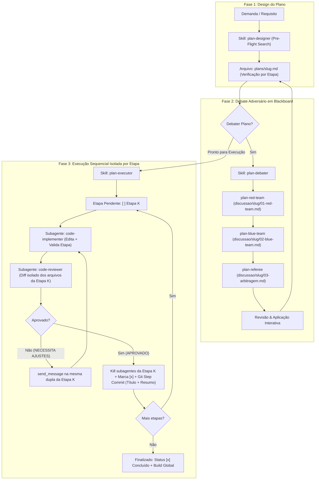

# Agent Orchestrator Plugin (v1.11.0)

Plugin para Antigravity que fornece uma suíte enxuta e otimizada em consumo de contexto e velocidade para o ciclo de desenvolvimento com subagentes:

1. **Design de Planos e Triagem Adaptativa (`plan-designer`)**: Analisa requisitos e contratos reais no código via busca nativa (`grep_search` / `find_by_name`). Em demandas padrão, decompõe a solução em etapas atômicas sequenciais com verificação polimórfica por etapa (`plans/<slug>.md`); em micro-tarefas ($\le 2$ arquivos), oferece o **Fast-Track** sob confirmação do usuário.
2. **Debate Adversário em *Blackboard* (`plan-debater`)**: Submete o plano a um debate rigoroso em `discussao/<slug>/` entre Red Team (`plan-red-team`) e Blue Team (`plan-blue-team`), julgado por um Árbitro Neutro (`plan-referee`) que filtra abstrações e escalas irreais, gerando um artefato nativo de visualização no Antigravity com links clicáveis para os relatórios de `discussao/` e consolidando críticas aceitas vs. ignoradas com opções contextualizadas e aplicação interativa via `ask_question`.
3. **Execução de Planos (`plan-executor`)**: Consome o arquivo do plano por referência, orquestra os subagentes `code-implementer` e `code-reviewer` com isolamento estrito por etapa (reutilizando a sessão via `send_message` apenas dentro do loop de ajustes da etapa e encerrando-a com `manage_subagents(Action="kill")` ao aprovar), atualiza o checklist (`- [x]`), executa o **Git Step Committer** (commit semântico atômico com título da etapa e descrição resumida do que foi feito), oferece **Rollback Cirúrgico** / **Re-anchoring Assistido** em caso de bloqueio e fecha o ciclo com o **End-of-Plan Gatekeeper** (validação de build global + resumo de PR inline).
4. **Ideação em *Blackboard* (`idea-orchestrator`)**: Pipeline de exploração (`project-explorer` em 2 camadas compactas), ideação em 3 eixos ortogonais (`feature-ideator`) e avaliação crítica (`feature-evaluator`) onde cada subagente lê e grava diretamente em `docs/ideation_report.md`, poupando >90% da janela de contexto do orquestrador.
5. **Auditoria e Limpeza de Code Slop (`find-code-slop`)**: Delega a varredura *search-first* e *tool-assisted* (com `grep_search`, linters estáticos nativos, *safe-list* anti-falso-positivo, modo delta e persistência em *Blackboard* para repositórios inteiros) de falhas silenciosas, *escape hatches* de tipagem, *test slop*, dead code e abstrações prematuras ao `code-slop-auditor`, orquestrando a limpeza aprovada via `ask_question` com o `code-implementer`.
6. **Geração Divergente em Trio (`divergent-trio`)**: Dispara concorrentemente 3 subagentes com prismas técnicos ortogonais (Minimalista/KISS, Robusta/Modular e Inovadora/Alternativa), persistindo cada solução diretamente em seu respectivo arquivo de artefato no diretório especificado pelo usuário e sintetizando uma matriz comparativa de trade-offs exclusivamente no chat (sem gerar arquivos extras de consolidação em disco).

---

## Ciclo de Vida: Design, Debate e Execução

---

## Estrutura do Pacote

- `plugin.json`: Manifesto do plugin (v1.11.0).
- `rules/AGENTS.md`: Regra enxuta ativa enquanto o plugin estiver habilitado.
- **Skills (`skills/`)**:
  - `plan-designer/SKILL.md`: Concepção e criação de planos com validação de contratos e verificação por etapa.
  - `plan-debater/SKILL.md`: Orquestração de debate Red Team vs. Blue Team com arbitragem em `discussao/` e limpeza de subagentes.
  - `plan-executor/SKILL.md`: Execução sequencial por referência, isolamento por etapa, loop via `send_message` e limpeza automática de subagentes.
  - `idea-orchestrator/SKILL.md`: Orquestração de ideação em 2 camadas + 3 eixos ortogonais com escrita direta em disco (*Blackboard*).
  - `find-code-slop/SKILL.md`: Auditoria isolada *search-first* & *tool-assisted* de code slop (modo delta ou *Blackboard*) com limpeza delegada ao `code-implementer`.
  - `divergent-trio/SKILL.md`: Orquestração concorrente de 3 subagentes divergentes com gravação direta de artefatos em pasta designada e consolidação no chat.
- **Subagentes (`agents/` — todos com `inheritCustomizations: false`, `inheritMcp: false` e ferramentas explícitas)**:
  - `plan-red-team.md`: Crítica adversária focada em riscos reais no código atual (anti-abstração) e invariante de build.
  - `plan-blue-team.md`: Defesa pragmática do plano (KISS/YAGNI, escala real e mitigações minimalistas).
  - `plan-referee.md`: Julgamento técnico neutro com filtragem de escala, inspeção de código e consolidação em duas seções.
  - `code-implementer.md`: Implementação cirúrgica com ferramentas nativas de escrita e validação rápida da etapa.
  - `code-reviewer.md`: Revisão somente leitura com diff isolado aos arquivos da etapa (`git --no-pager diff -- <arquivos>`) e sem rebuild redundante.
  - `project-explorer.md`: Diagnóstico arquitetural em 2 camadas (teto de 80 linhas) e gravação da Seção 1 no *Blackboard*.
  - `feature-ideator.md`: Brainstorming técnico em 3 eixos ortogonais e gravação da Seção 2 no *Blackboard*.
  - `feature-evaluator.md`: Filtragem crítica, matriz de priorização e gravação das Seções 3–5.
  - `code-slop-auditor.md`: Varredura *search-first* & *tool-assisted* de dead code, *test slop*, *escape hatches* de tipagem e antipatterns com *safe-list* anti-falso-positivo.
  - `divergent-generator.md`: Geração técnica especializada de soluções sob prismas arquiteturais designados com persistência direta de artefato em disco.
