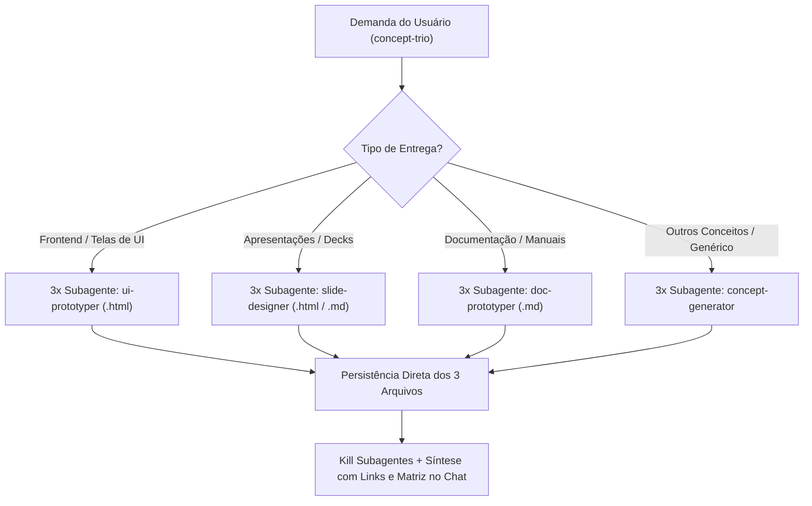

# Concept Prototyper Plugin (v1.1.0)

Plugin para Antigravity voltado para **ideação, concepção visual e prototipagem exploratória com subagentes especializados**, sem alterar o código de produção do projeto.

---

## Arquitetura de Subagentes Especializados

Para entregar a maior fidelidade técnica e estética possível em cada tipo de entrega, o plugin utiliza um **roteador inteligente** com subagentes especializados por use case, além de um subagente genérico para prototipagem conceitual livre:



---

## Subagentes do Pacote

1. **`ui-prototyper`** (Especialista em Frontend / UI):
   - Focado em mockups de tela 100% autocontidos (`.html`), responsivos, com Tailwind CSS via CDN, ícones SVG inline, dados realistas do domínio e micro-interatividade em JavaScript vanilla (tabs, modais, filtros, dark/light mode).
2. **`slide-designer`** (Especialista em Slides & Storytelling):
   - Focado em estruturas de apresentação, pitch decks e narrativas visuais (decks interativos em HTML com navegação por teclado ou roteiros detalhados em Markdown com speaker notes).
3. **`doc-prototyper`** (Especialista em Documentação Técnica):
   - Focado em arquitetura de informação e redação técnica (tutoriais hands-on, referências formais de arquitetura ou cookbooks de casos de uso com diagramas Mermaid e alertas semânticos).
4. **`concept-generator`** (Generalista / Fallback Conceitual):
   - Focado em qualquer outra necessidade exploratória (modelagem de dados relacional vs. NoSQL, schemas GraphQL/REST, fluxos de esteiras de automação, templates de e-mail ou PRDs conceituais).

---

## Estrutura do Pacote

- `plugin.json`: Manifesto do plugin (v1.1.0).
- `assets/logo.svg`: Logo visual em vetor com alto contraste.
- `rules/AGENTS.md`: Diretrizes ativas de prototipagem e preservação de código de produção.
- `skills/concept-trio/SKILL.md`: Orquestração de 3 subagentes com roteamento por use case e consolidação no chat.
- `agents/`:
  - `ui-prototyper.md`: Subagente de telas e interfaces em HTML.
  - `slide-designer.md`: Subagente de decks e slides.
  - `doc-prototyper.md`: Subagente de documentações técnicas.
  - `concept-generator.md`: Subagente genérico para demais conceitos.

---

## Exemplos de Uso no Chat

```text
# 1. Telas de Frontend (aciona 3x ui-prototyper)
"Quero ver 3 opções visuais em HTML para a nova tela de extrato bancário na pasta mockups/extrato/."

# 2. Apresentações / Decks (aciona 3x slide-designer)
"Crie 3 estruturas de slides para apresentar o novo plano de observabilidade em decks/observabilidade/."

# 3. Documentação (aciona 3x doc-prototyper)
"Gere 3 propostas de documentação para o nosso SDK de mensageria na pasta docs/propostas/."

# 4. Outros Conceitos Genéricos (aciona 3x concept-generator)
"Crie 3 propostas conceituais de modelagem de dados para o sistema de notificações em concepts/notificacoes/."
```
